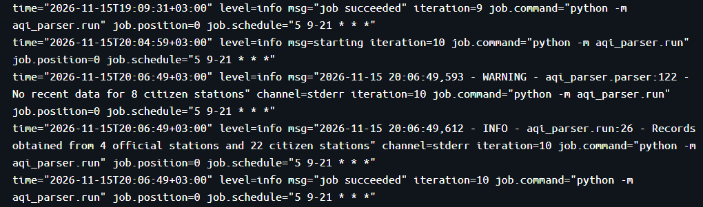

# AQI Moscow Tracker
[](#)
[](#)
[](#)


### ETL-система мониторинга качества воздуха (AQICN API)

- Сбор данных с 30 официальных и 50 частных станций измерения AQI (Air Quality Index) по расписанию каждый час с 9:00 до 21:00.
- Нормализация данных, разделение на официальные/частные станции, хеширование координат для связности.
- Загрузка в SQLite с проверкой уникальности.
- Логирование ошибок, автоматический перезапуск при сбоях, тесты на корректность парсинга.

#### База данных

**`Station`** - обновляемый справочник станций (`coord_hash` - хэш координат используется для связи)<br>
**`AirOfficial`** - полные данные с официальных станций (полный набор: AQI, PM, NO2, CO, погода)<br>
**`AirCitizen`** - неполные данные с частных станций (только AQI, PM2.5, PM10)<br>

## Стек

- Python 3.11 (Requests, Tenacity, Sqlite3)
- Sqlite (Хранение)
- Docker (Автозапуск)
- Supercronic (Расписание)

## Структура

AQICN API --> collector (Supercronic) --> SQLite (volume)

## Примеры
_Станции получены в пределах заданного bbox в запросе. Border Box для Москвы: `latlng=55.57,37.35,55.92,37.85`.<br>_




## Запуск

**1. Клонируй:**
```bash
git clone https://github.com/Rinaish/air-quality-parser.git
cd air-quality-parser
```

**2. Зарегистрируйся на [AQICN API Token](https://aqicn.org/data-platform/token/ru/) и получи токен API**

**3. Настрой токен в .env**
```bash
cp .env.example .env
```

**4. Инициализируй базу данных и таблицы**
```bash
python init_db.py
```

**5. Запусти**
```bash
docker compose up --build -d
```

## Дисклеймер 
- Атрибуция: [World Air Quality Index Project](https://waqi.info/) и исходные поставщики данных, включая [Moscow State environmental monitoring](https://mosecom.mos.ru/) для официальных станций (Мосэкомониторинг).
- Данные являются неофициальными, не прошли полную верификацию и могут быть изменены в любое время. Они не предназначены для официальных сравнений, отчетов или медицинских рекомендаций.
- Проект создан в образовательных/демонстрационных целях.